<div align="center">

<picture>
  <source media="(prefers-color-scheme: dark)" srcset="logo_escuro.png">
  
</picture>

# TECGEO Fotogrametria

**Aerofotogrametria com drone, do voo ao produto cartográfico — direto no Windows.**

Ortomosaico · MDS · MDT · nuvem de pontos classificada · modelo 3D · relatório técnico com PEC-PCD

[](https://github.com/montieur/tecgeo-fotogrametria-instalador/releases/latest)
-28b0e5?style=flat-square)


<a href="https://github.com/montieur/tecgeo-fotogrametria-instalador/releases/latest"></a>

<br><br>

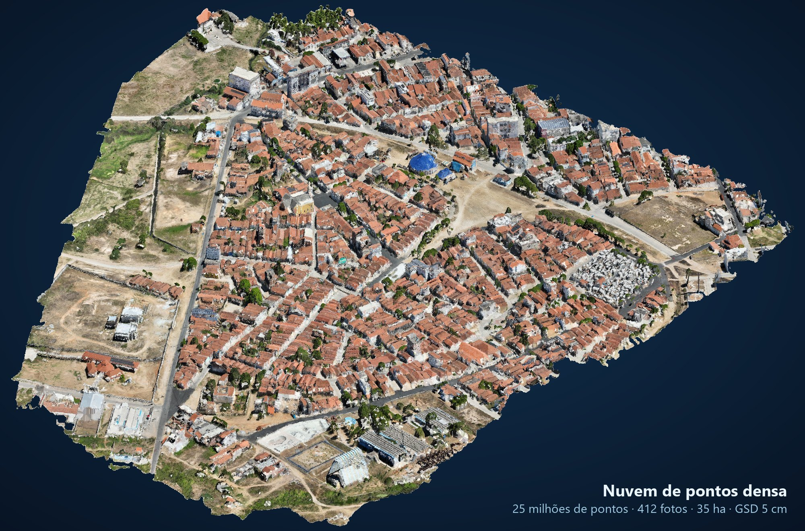

<sub>Levantamento urbano processado no TECGEO Fotogrametria — DJI Mavic 3 Enterprise, 412 fotos, 7 pontos de controle.</sub>

</div>

---

## Visão geral

O **TECGEO Fotogrametria** é a ferramenta da TECGEO para processar voos de drone com o motor de código aberto
[OpenDroneMap](https://github.com/OpenDroneMap/ODM), **nativo no Windows** — sem Docker, WSL ou máquina virtual.
Uma interface em seis passos conduz do conjunto de fotos ao produto final, com pontos de controle, área de interesse,
estimativa de tempo, acompanhamento do processamento e controle de qualidade cartográfica.

| | |
|---|---|
| **Georreferenciamento** | Pontos de controle em TXT, CSV, XLSX, KML/KMZ, GeoJSON, SHP, GPKG, DXF ou `gcp_list`; SIRGAS 2000 / UTM detectado automaticamente; previsão da posição do alvo em cada foto |
| **Produtos** | Ortomosaico e MDS/MDT em GeoTIFF otimizado (COG) com resolução em cm por raster; nuvem LAZ 1.4 classificada; nuvem só do solo; modelo 3D texturizado (OBJ) |
| **Terreno** | MDT por **CSF (simulação de tecido)** com predefinições por tipo de terreno — remove edificações e vegetação mesmo em quadras urbanas densas |
| **Qualidade** | Resíduos por ponto de controle, alerta de ponto destoante, conferência de produtos e **classificação PEC-PCD (ET-CQDG)** por escala |
| **Operação** | Processamento independente da interface (pode fechar a janela), retomada por etapa, aviso de término na bandeja, estimativa de tempo calibrada pela máquina |

---

## Produtos

<table>
<tr>
<td width="50%">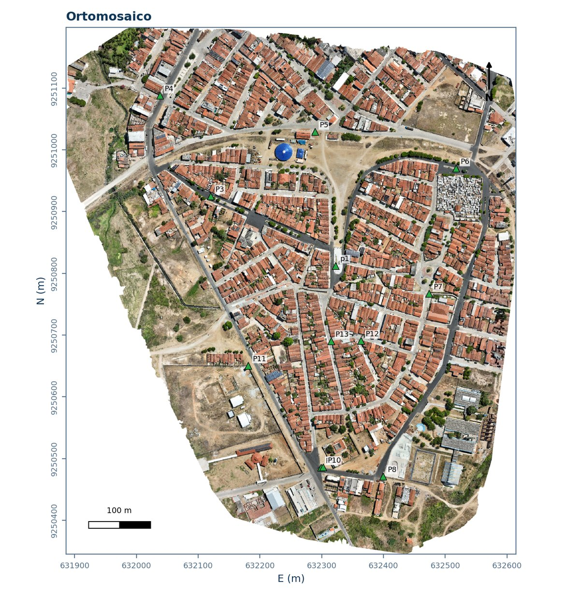<br><b>Ortomosaico</b> — GeoTIFF COG, pontos de controle sobrepostos</td>
<td width="50%">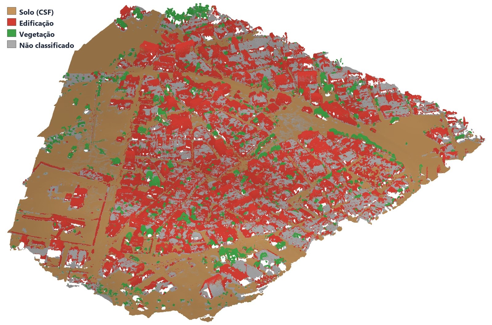<br><b>Nuvem de pontos classificada</b> — solo, edificação e vegetação (LAZ 1.4)</td>
</tr>
<tr>
<td>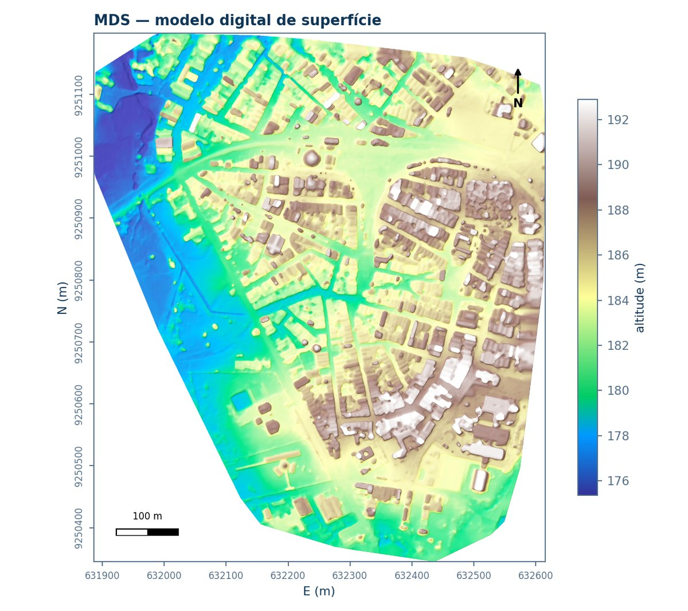<br><b>MDS</b> — modelo digital de superfície, hipsometria com relevo sombreado</td>
<td>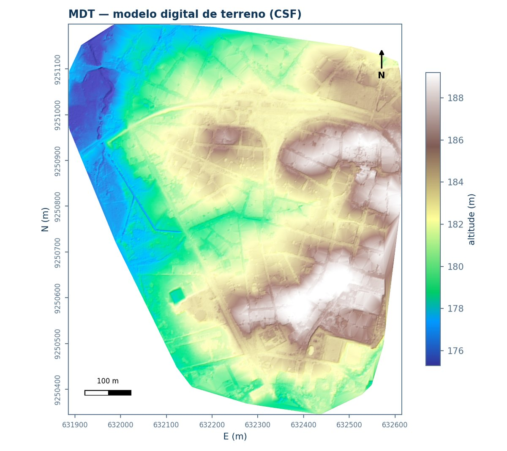<br><b>MDT</b> — terreno nu, edificações removidas por CSF</td>
</tr>
</table>

<div align="center">
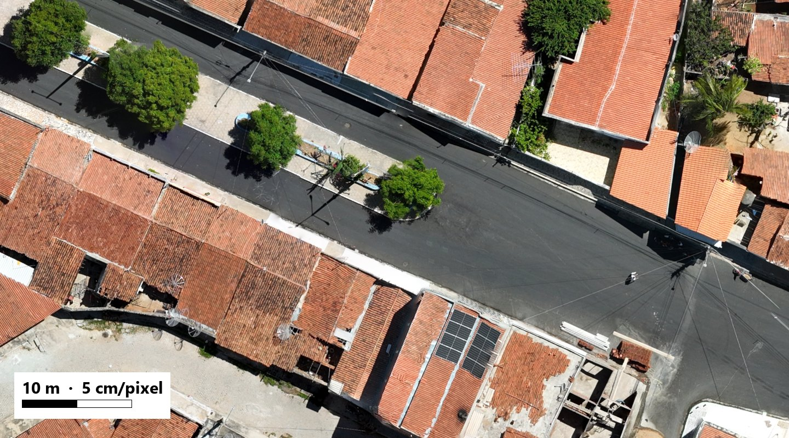
<sub>Detalhe do ortomosaico em resolução total (5 cm/pixel).</sub>
</div>

---

## Fluxo de trabalho em 6 passos

### 1 · Projeto
Projetos com renomear, duplicar, adicionar fotos e excluir para a Lixeira. A ficha **"Esta máquina"** confere OpenDroneMap,
processador, memória, placa de vídeo e espaço em disco.

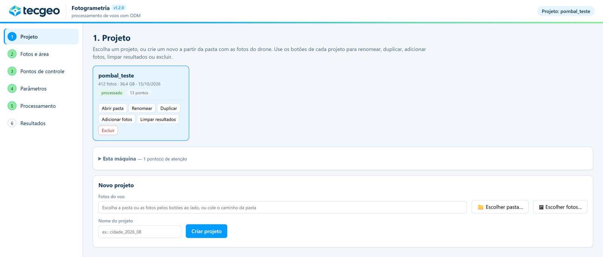

### 2 · Fotos e área de interesse
Fotos no mapa com data, horário e GSD do voo. A **área de interesse** desenhada no mapa recorta os produtos e seleciona só as
fotos que a enxergam — processamento mais rápido.

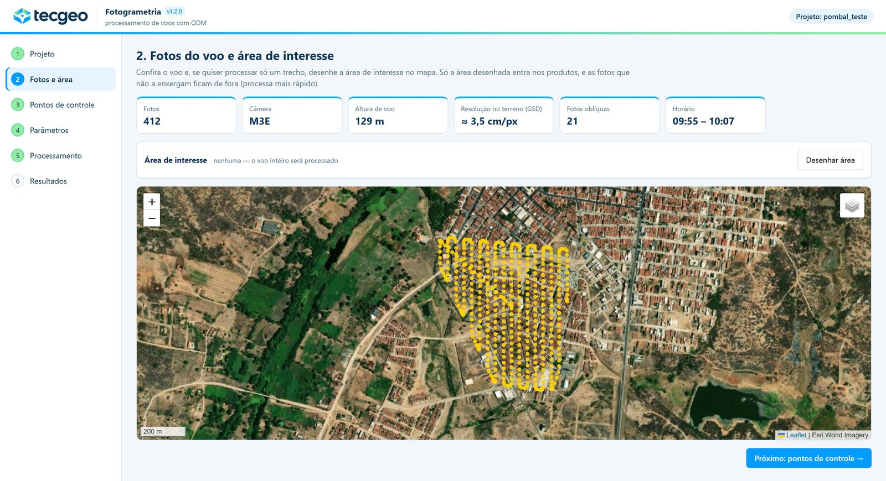

### 3 · Pontos de controle
Importação em vários formatos, com detecção do sistema de coordenadas. Para cada ponto o programa **prevê onde o alvo
aparece em cada foto** e a marcação é feita num visor com cruzeta, minilupa e ajuste fino pelo teclado.

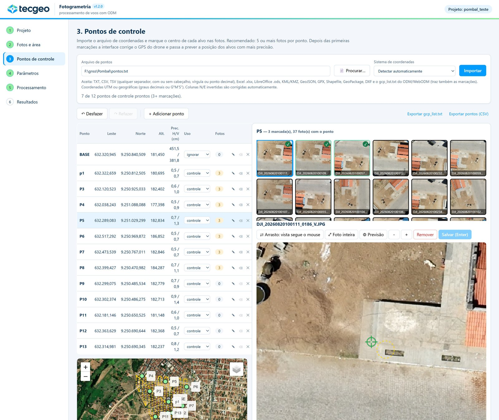

<div align="center">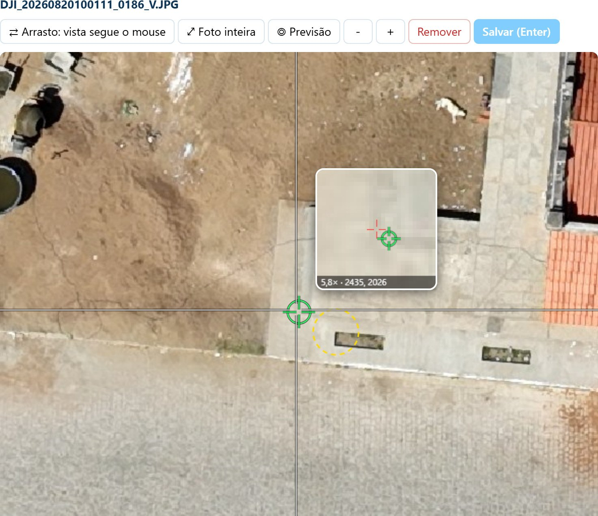<br>
<sub>Visor de marcação: cruzeta, minilupa com coordenadas da foto e desfazer/refazer.</sub></div>

### 4 · Parâmetros
Perfil de qualidade, resolução em cm de ortomosaico, MDS e MDT (sugerida pelo GSD), método do MDT e tipo de terreno,
e o **tempo estimado** por etapa, com avisos de disco e memória.

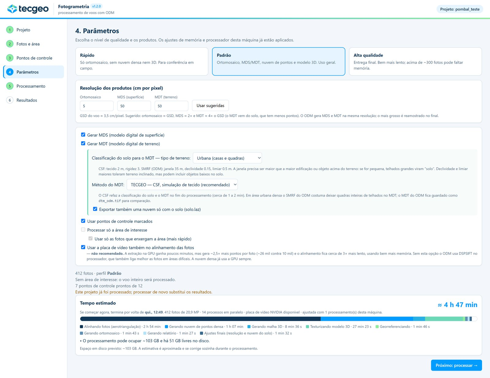

### 5 · Processamento
O processamento roda de forma independente: fechar o navegador ou o programa não interrompe. Acompanhamento por etapa
com previsão de término, uso de processador, placa de vídeo, memória e disco, e registro completo do motor.

### 6 · Resultados e relatório
Produtos com atalho para abrir cada arquivo, conferência de precisão nos pontos de checagem e **relatório técnico em PDF**.

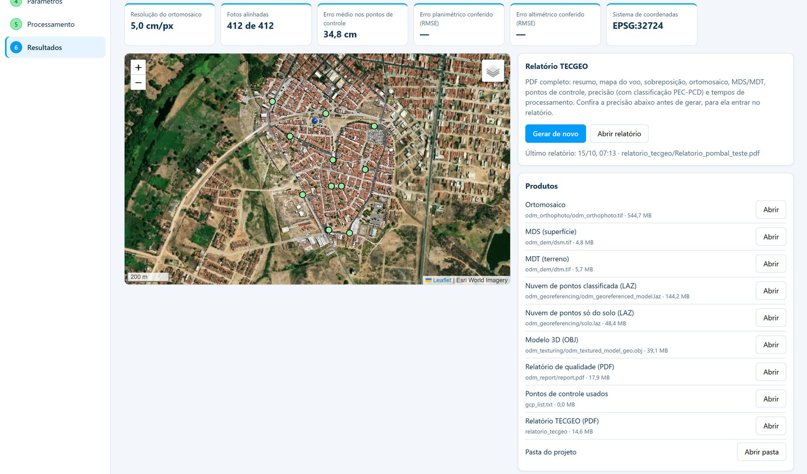

<table>
<tr>
<td width="50%">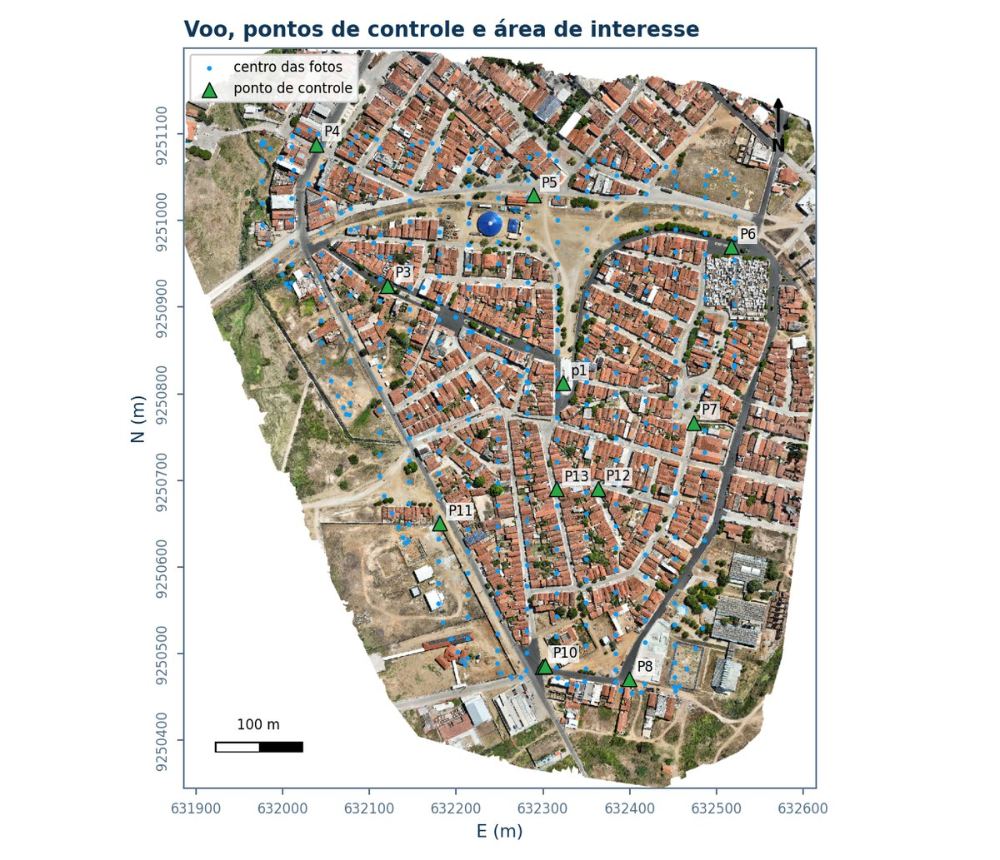<br>Relatório — mapa do voo e posição das fotos</td>
<td width="50%">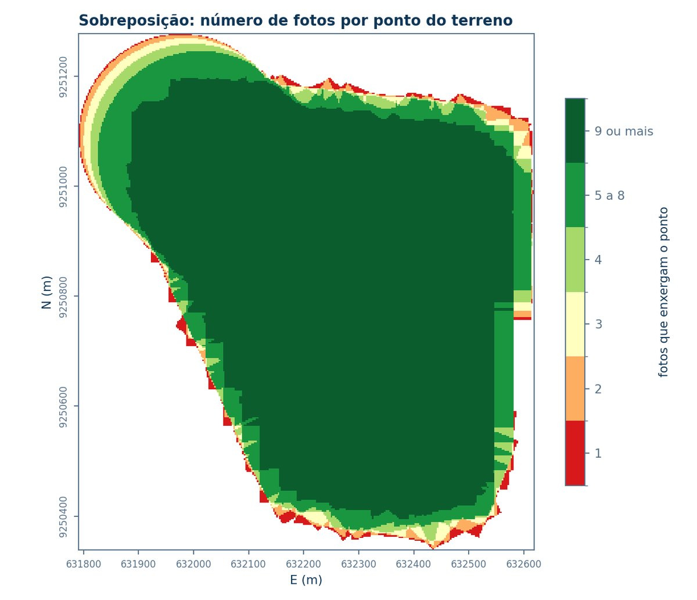<br>Relatório — sobreposição (fotos por ponto do terreno)</td>
</tr>
</table>

O relatório reúne resumo do voo e do processamento, figuras dos produtos, resíduos dos pontos de controle
(ΔE, ΔN, ΔH, RMSE), **classificação PEC-PCD** de 1:500 a 1:10.000 e por equidistância de curvas, e os alertas de qualidade.

---

## Instalação

1. Baixe **`TECGEO-Fotogrametria-Setup-<versão>.exe`** na [última versão](https://github.com/montieur/tecgeo-fotogrametria-instalador/releases/latest) e dê dois cliques.
2. No assistente:
   - escolha a **pasta dos projetos** — o instalador sugere o disco com mais espaço livre (cada voo ocupa de 30 a 100 GB);
   - deixe marcado **"Baixar e instalar o OpenDroneMap agora"** (~234 MB do GitHub oficial do OpenDroneMap, com conferência
     de SHA-256 e assinatura digital; o Windows pede permissão de administrador só nesta parte).
3. Ao concluir, o programa abre no navegador, pronto para usar.

> [!NOTE]
> O instalador não tem assinatura de código. Se o Windows mostrar **"O Windows protegeu o computador"**,
> clique em **Mais informações → Executar assim mesmo**.

**Atualizar** — rode o instalador da versão nova por cima: projetos, configuração e OpenDroneMap são mantidos.
O programa avisa no topo da tela quando há versão nova.

**Desinstalar** — *Configurações → Aplicativos → TECGEO Fotogrametria*. Remove o programa e o OpenDroneMap e **mantém a pasta dos projetos**.

<details>
<summary><b>Instalação silenciosa (TI)</b></summary>

```bat
TECGEO-Fotogrametria-Setup-<versão>.exe /VERYSILENT /PROJETOS="D:\TECGEO-Projetos" /TASKS="odm,atalho"
```

</details>

## Requisitos

| Item | Mínimo | Recomendado |
|---|---|---|
| Sistema | Windows 10/11 64 bits | Windows 11 |
| Processador | 4 núcleos | 8 núcleos / 16 threads |
| Memória | 16 GB | 32 GB |
| Placa de vídeo | opcional | NVIDIA (acelera a nuvem de pontos densa) |
| Disco | ~3 GB para o programa + 30–100 GB por voo | SSD com bastante espaço livre |

Nenhuma outra instalação é necessária: o programa usa o Python e as bibliotecas geoespaciais (GDAL, PDAL, PROJ) que vêm
com o OpenDroneMap, e o .NET Framework do Windows.

**Referência de desempenho** — voo urbano de 412 fotos de 20 MP (perfil Padrão, MDS/MDT a 50 cm) em Ryzen 7 7735HS,
32 GB e RTX 4050 Laptop: estimativa de cerca de 3 horas do início ao relatório.

## Arquivos de cada versão

| Arquivo | Para quê |
|---|---|
| `TECGEO-Fotogrametria-Setup-<versão>.exe` | instalador (recomendado) |
| `TECGEO-Fotogrametria-v<versão>.zip` | pacote portátil: extrair e abrir `TECGEO Fotogrametria.exe` |

O SHA-256 de cada arquivo e o que mudou estão nas [notas de cada versão](https://github.com/montieur/tecgeo-fotogrametria-instalador/releases).

---

<div align="center">
<sub>TECGEO · ferramenta de uso interno<br>
Motor de processamento: <a href="https://github.com/OpenDroneMap/ODM">OpenDroneMap</a> (AGPL-3.0), instalado à parte · Mapa de fundo: Esri World Imagery</sub>
</div>
